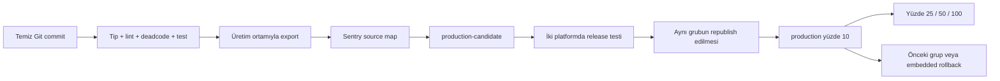

# Bluma EAS OTA operasyon rehberi

OTA, JavaScript ve paketlenmiş görselleri günceller. SDK, native modül, izin,
config plugin veya yerel `modules/` kodu değiştiğinde yeni native build gerekir.
`fingerprint` politikası uyumsuz paketin eski binary'ye gitmesini engeller.

## Tasarım



| Build profili / kanal | EAS ortamı | Kullanım |
|---|---|---|
| development | development | Metro geliştirme; otomatik OTA kapalı |
| preview | preview | Dahili release testi |
| production-candidate | production | Üretime gidecek paketin dahili testi |
| production | production | Mağaza binary'si, kontrollü OTA |

Kanallar aynı adlı EAS dallarına bağlıdır. Dal bazlı rollout yerine grup
bazlı rollout kullanılır. Scriptler farklı dal eşlemesini ve duraklatılmış
kanalları reddeder. Preview paketi üretime taşınamaz: ortam değerleri farklı
olabilir. Aday paket üretim ortamında bir kere üretilir, sonra yeniden
bundle edilmeden republish edilir.

Bu ayrım **OTA dağıtımı ve ortam değişkenleri içindir**. Firebase dosyaları
ortaktır; preview ayrı bir veritabanı değildir. Test hesaplarını buna göre
kullanın. Firebase ortam ayrımı ayrı bir native yapılandırma çalışmasıdır.

## İlk kurulum

1. Bu projeye yetkili hesapla `npx eas-cli@24.12.1 login` yapın.
2. Yerel `.env` dosyasında `.env.example` içindeki üç `EXPO_PUBLIC_*`
   değişkenini doldurun. DSN ve bu anahtarlar uygulama paketinde görünür;
   EAS görünürlüğü `sensitive` veya `plaintext` olmalı, `secret` olmamalı.
3. `yarn ota:setup` çalıştırın. Eksik kanalları ve eksik değişkenleri ekler;
   mevcut değerleri ezmez. Her ortamın değerlerini EAS panelinde doğrulayın.
   Native source map için `.env` içinde Sentry Organization Token tanımlayıp
   `yarn ota:setup-sentry` çalıştırın. Token üç EAS ortamında `sensitive` tutulur;
   app config yalnızca org/proje içerir. `SENTRY_DISABLE_AUTO_UPLOAD` kullanmayın.
4. Değişiklikleri inceleyip commit edin. Yayın temiz Git ağacı gerektirir.
5. Aşağıdaki native build'leri oluşturun. Daha önce mağazaya gönderilen,
   `expo-updates` içermeyen binary'lere bu altyapı OTA ile eklenemez.

```bash
npx eas-cli@24.12.1 build --profile production --platform all
# autoIncrement yerel sürüm numaralarını değiştirir; yeni değerleri commit edin.
# Üretim binary'sinin aynı app config / bağımlılıklarıyla aday binary üretin.
npx eas-cli@24.12.1 build --profile production-candidate --platform all
npx eas-cli@24.12.1 build --profile preview --platform all
```

Mağaza sürümünü göndermeden önce aday/üretim runtime fingerprint'lerinin her
platform için aynı olduğunu EAS build detaylarından doğrulayın. iOS ve Android
runtime'ları birbirinden farklı olabilir. Build numarası, app config, eas.json
ve bağımlılık değişiklikleri de fingerprint'i etkileyebilir; uyuşmazlıkta
runtime'ı elle değiştirmeyin, ilgili binary'yi yeniden üretin.

Kökteki `ios/` ve `android/` prebuild çıktıları Git tarafından yok sayılır;
fingerprint CNG hesabı da bunları dışlar. `modules/*/ios` ve `modules/*/android`
native kaynakları korunur ve fingerprint'e dahildir. `.fingerprintignore`
ile native bağımlılıkları dışlayarak uyumluluk kontrolünü zayıflatmayın.

## CI ve erişim

GitHub Actions içinde `EAS OTA` iş akışı manuel başlatılır. Otomatik production
yayını yoktur. `Kalite` iş akışı pull request ve main/master push'larında çalışır.

GitHub Settings → Environments içinde **önceden** oluşturun:

- `ota-preview`: yetkili `EXPO_TOKEN` secret.
- `ota-candidate`: `EXPO_TOKEN`, `SENTRY_AUTH_TOKEN` secrets;
  `SENTRY_ORG`, `SENTRY_PROJECT` variables.
- `ota-production`: `EXPO_TOKEN` secret; required reviewers ve izin verilen
  yayın branch'lerini ayarlayın. İkinci yetkili varsa kendi onayını engelleyin.

Bu depo için üç environment oluşturuldu ve yalnızca `main` branch'i izinli.
Production onaycısı `asamethon`; depodaki tek yetkili olduğu için kendi
başlattığı işi ayrıca onaylayabilir. Bu, iki kişi tarafından onay değildir.
Üç ortamda `EXPO_TOKEN`, preview/candidate içinde `SENTRY_AUTH_TOKEN` ve Sentry
variables ayarlandı. Expo robotu Release Manager rolünde. Bu yerel workflow
dosyaları commit edilip `main` branch'ine gönderilmeden Actions'ta görünmez.

Environment korumaları YAML tarafından oluşturulmaz; ayarlanmadıysa GitHub
onay istemez. Token'ı yalnızca yetkili yayıncılara verin ve varsayılan branch'i
koruyun. Expo hesabında erişim yetkilerini de sınırlandırın. Tek concurrency
grubu yayınları sıraya alır; çalışan yayın iptal edilmez. Manuel CLI yayınlarını
CI ile eşzamanlı çalıştırmayın; CI dışı komutlar bu kilidi paylaşmaz.

Source map yüklemesi aday yayınından **önce** yapılır; başarısızsa yayın durur.
Metro mevcut Sentry entegrasyonuyla debug ID üretir. Native release/dist
korunur; OTA kanal, runtime ve update ID hata kayıtlarına etiketlenir.
Preview'da source map yüklemesi token varsa yapılır.
Export kontrolü iki platformda dolu paket, source map ve debug ID gerektirir.

Yerel aday yayını için Sentry değişkenlerini kabuğa export edin; scriptler
yerel `.env` kullanmaz. Expo Build/Update aynı EAS ortamını kullanır.
`ota:setup` yalnızca ilk kurulum için yerel `.env` okuyabilir.

## Günlük yayın

```bash
yarn ota:check
yarn ota:publish --channel preview --message "Okuyucu düzeltmesi"
yarn ota:publish --channel production-candidate --message "Okuyucu düzeltmesi"
# Dönen candidate grup UUID'sini aşağıda kullanın.
yarn ota:promote --group CANDIDATE_GROUP_UUID --message "Okuyucu düzeltmesi" --percentage 10
# Promote yeni bir production grup UUID üretir. Artışta bu yeni ID kullanılır.
yarn ota:rollout --group PRODUCTION_GROUP_UUID --percentage 25
yarn ota:rollout --group PRODUCTION_GROUP_UUID --percentage 50
yarn ota:rollout --group PRODUCTION_GROUP_UUID --percentage 100
```

Publish tip/lint/deadcode/test kapısını ve EAS ortam doğrulamasını çalıştırır.
Promote kaynak dalını, grup ID'sini, platformları ve her runtime için bitmiş
production build varlığını kontrol eder. Grup UUID kullanın; platform update
UUID'si kabul edilmez. Tek platform için `--platform ios` veya `android` verin.

Bir rollout bitmeden aynı runtime'a yeni yayın yapılmaz; EAS bunu da denetler.
Oranlar kendiliğinden artırılmaz. Her adımda EAS Update indirme/başlatma
ölçümlerini ve Sentry'de ilgili `ota.updateId` / `ota.runtime` kayıtlarını
kontrol edin. Önerilen bekleme: en az 30 dakika ve iki platformda yeterli
gerçek kullanım; düşük trafikte süreyi uzatın. Yeni crash, emergency launch,
oturum/veri kaybı veya okuyucu/editör hatasında artışı durdurup geri alın.

Başarılı işlem `.ota/release.json` üretir: Git commit, zaman, grup ve runtime
bilgileri. CI ayrıca bu kaydı ve EAS metadata dosyasını 90 gün saklar.
İlk production build/OTA grubunu ve her yayından önceki sağlam grup UUID'sini
operasyon kaydına ekleyin; yalnızca “son grup” ifadesine güvenmeyin.

## Acil geri alma

```bash
# Aynı runtime'ın bilinen sağlam production grubuna dönün; tüm kullanıcılara.
yarn ota:rollback --group GOOD_PRODUCTION_GROUP_UUID --message "Okuyucu hatası geri alındı"
# Sağlam OTA yoksa binary'ye gömülü pakete dönün. Platform runtime'ını kullanın.
yarn ota:embedded --runtime IOS_RUNTIME_HASH --platform ios --message "Güvenli pakete dönüş"
yarn ota:embedded --runtime ANDROID_RUNTIME_HASH --platform android --message "Güvenli pakete dönüş"
# Gerekirse yeni indirmeleri geçici durdurun / yeniden açın.
npx eas-cli@24.12.1 channel:pause production --non-interactive
npx eas-cli@24.12.1 channel:unpause production --non-interactive
```

Rollback aktif grup rollout'unu zorla sonlandırır; kalite kapısını veya yeniden
bundle işlemini beklemez. Kanal duraklatılmışsa rollback öncesi unpause gerekir.
Pause indirilmiş paketleri cihazdan silmez. Rollback de bir sunucu yönergesidir:
cihazın internete bağlanması ve sonraki soğuk açılışı gerekir. Çevrimdışı veya
açık bir oturumdaki bütün cihazları anında geri döndürme garantisi yoktur.

Uygulama açılışından sonra/foreground'da arka planda kontrol eder; başarılı
kontrolde 30 dakika, hatada 5 dakika bekler. Bağlantı yoksa bekleme başlatmaz.
Tek indirme çalışır. İndirmeden sonra da 30 dakikalık aralıkla kontrol sürer;
geri çekilmiş bir paketin rollback yönergesi sonraki foreground'da alınabilir.
Normal güncelleme ve embedded rollback diske indirilir;
otomatik `reloadAsync` çağrılmaz, yazı taslağı veya okuma oturumu kesilmez.
Native hata kurtarma, gömülü paket ve anti-bricking koruması açık kalır.
Expo'nun otomatik kurtarması her çalışma zamanı hatasını çözmez; uygulama
veri migrasyonları geri alınabilir ve eski paketle uyumlu tasarlanmalıdır.

## Gerçek cihaz kabul testi

- İki platformda **release** candidate build kurun; Expo Go/dev client yeterli değil.
- Aday yayınlayın, uygulamayı açıp indirmeyi bekleyin; tam kapatıp yeniden açın.
  Çalışan update ID'yi Sentry/EAS ile doğrulayın.
- Okuyucu, yazı taslağı, giriş, çevrimdışı kütüphane ve bildirim rotalarını deneyin.
- Çevrimdışı açılış, bağlantı dönüşü ve arka plan/ön plan geçişlerini kontrol edin.
- Test runtime'ında sağlam gruba geri dönüşü ve embedded rollback'i deneyin.
- Native bağımlılık değişiminde eski binary'nin uyumsuz OTA almadığını doğrulayın.

## İsteğe bağlı imzalama

Uçtan uca OTA code signing, Expo Production/Enterprise planı gerektirir.
Plan doğrulanmadan sahte sertifika veya private key eklenmedi. Etkinleştirilecekse
Expo rehberine göre public sertifikayı app config'e ekleyin, private key'i ayrı
secret olarak tutun; yayın/republish/rollback scriptlerine private-key-path
bağlayıp yeni native build alın. Anahtarı repoya veya `.env.example`'a yazmayın.

Kaynaklar: [runtime uyumluluğu](https://docs.expo.dev/eas-update/runtime-versions/),
[rollout](https://docs.expo.dev/eas-update/rollouts/),
[rollback](https://docs.expo.dev/eas-update/rollbacks/),
[SDK 56 Updates](https://docs.expo.dev/versions/v56.0.0/sdk/updates/),
[ortam değişkenleri](https://docs.expo.dev/eas/environment-variables/),
[code signing](https://docs.expo.dev/eas-update/code-signing/).
